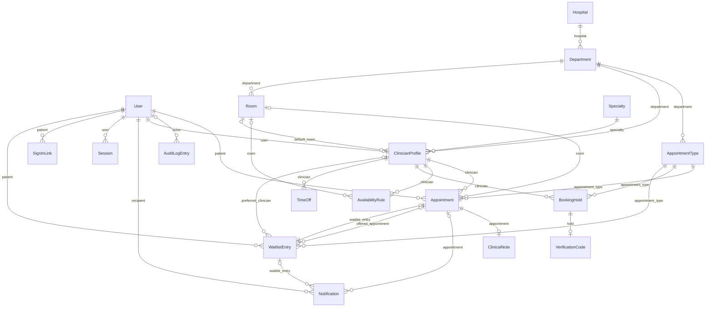

# Data model

Generated from the models by `python manage.py render_data_model`; a test fails when
this file is stale. Do not edit by hand.

Every identifier is a UUIDv7 (ADR 0002). Every model also carries `created_at`,
`updated_at` and `created_by` (a User; empty when the system or a visitor made the row).
No relation cascades: deleting a referenced row fails in the database.

## Relationships

## Appointment

Table `scheduling_appointment`.

FHIR: Appointment

| Field | Type | Null | Rule |
| --- | --- | --- | --- |
| `id` | UUIDField | no | primary key; at most 32 characters |
| `created_at` | DateTimeField | no |  |
| `updated_at` | DateTimeField | no |  |
| `created_by` | ForeignKey | yes | refers to User, protected |
| `version` | PositiveIntegerField | no |  |
| `patient` | ForeignKey | no | refers to User, protected |
| `clinician` | ForeignKey | no | refers to ClinicianProfile, protected |
| `appointment_type` | ForeignKey | no | refers to AppointmentType, protected |
| `room` | ForeignKey | yes | refers to Room, protected |
| `starts_at` | DateTimeField | no |  |
| `ends_at` | DateTimeField | no |  |
| `status` | CharField | no | at most 20 characters; one of BOOKED, CONFIRMED, CHECKED_IN, COMPLETED, CANCELLED, NO_SHOW |
| `source` | CharField | no | at most 20 characters; one of ONLINE, ROUND_ROBIN, STAFF |
| `patient_reason` | TextField | no |  |
| `cancelled_at` | DateTimeField | yes |  |
| `cancellation_reason` | TextField | no |  |
| `waitlist_entry` | OneToOneField | yes | unique; refers to WaitlistEntry, protected |
| `inherited_version` | PositiveIntegerField | no |  |

Constraints:

- `appointment_cancellation_only_when_cancelled` (check): cancellation time and reason exist exactly when the status is CANCELLED
- `appointment_ends_at_after_starts_at` (check): ends_at must be after starts_at
- `appointment_inherited_version_only_from_waitlist` (check): an inherited version needs a waitlist entry
- `appointment_no_overlap_for_clinician` (exclusion): the clinician already has an appointment at that time
- `appointment_no_overlap_for_patient` (exclusion): the patient already has an appointment at that time
- `appointment_no_overlap_for_room` (exclusion): the room already has an appointment at that time
- `appointment_source_listed` (check): source must be one of ONLINE, ROUND_ROBIN, STAFF
- `appointment_status_listed` (check): status must be one of BOOKED, CONFIRMED, CHECKED_IN, COMPLETED, CANCELLED, NO_SHOW

## AppointmentType

Table `scheduling_appointmenttype`.

FHIR: HealthcareService

| Field | Type | Null | Rule |
| --- | --- | --- | --- |
| `id` | UUIDField | no | primary key; at most 32 characters |
| `created_at` | DateTimeField | no |  |
| `updated_at` | DateTimeField | no |  |
| `created_by` | ForeignKey | yes | refers to User, protected |
| `version` | PositiveIntegerField | no |  |
| `department` | ForeignKey | no | refers to Department, protected |
| `name` | CharField | no | at most 200 characters |
| `code` | CharField | no | at most 50 characters |
| `duration_minutes` | SmallIntegerField | no |  |
| `needs_room` | BooleanField | no |  |
| `buffer_minutes` | SmallIntegerField | no |  |
| `colour` | CharField | no | at most 7 characters |
| `is_active` | BooleanField | no |  |
| `is_bookable_online` | BooleanField | no |  |

Constraints:

- `appointmenttype_buffer_minutes_at_least_0` (check): buffer_minutes must be at least 0
- `appointmenttype_code_not_blank` (check): code must not be empty
- `appointmenttype_code_unique` (unique): code is taken
- `appointmenttype_colour_hex` (check): colour must be a lower case #rrggbb value
- `appointmenttype_duration_minutes_at_least_1` (check): duration_minutes must be at least 1
- `appointmenttype_name_not_blank` (check): name must not be empty

## AuditLogEntry

Table `scheduling_auditlogentry`.

FHIR: AuditEvent

| Field | Type | Null | Rule |
| --- | --- | --- | --- |
| `id` | UUIDField | no | primary key; at most 32 characters |
| `updated_at` | DateTimeField | no |  |
| `created_by` | ForeignKey | yes | refers to User, protected |
| `version` | PositiveIntegerField | no |  |
| `created_at` | DateTimeField | no |  |
| `actor` | ForeignKey | yes | refers to User, protected |
| `action` | CharField | no | at most 100 characters |
| `entity_type` | CharField | no | at most 100 characters |
| `entity_id` | CharField | no | at most 64 characters |
| `metadata` | JSONField | no |  |
| `correlation_id` | CharField | no | at most 100 characters |

Constraints:

- `auditlogentry_action_not_blank` (check): action must not be empty
- `auditlogentry_correlation_id_not_blank` (check): correlation_id must not be empty
- `auditlogentry_entity_id_not_blank` (check): entity_id must not be empty
- `auditlogentry_entity_type_not_blank` (check): entity_type must not be empty

## AvailabilityRule

Table `scheduling_availabilityrule`.

FHIR: Schedule

| Field | Type | Null | Rule |
| --- | --- | --- | --- |
| `id` | UUIDField | no | primary key; at most 32 characters |
| `created_at` | DateTimeField | no |  |
| `updated_at` | DateTimeField | no |  |
| `created_by` | ForeignKey | yes | refers to User, protected |
| `version` | PositiveIntegerField | no |  |
| `clinician` | ForeignKey | no | refers to ClinicianProfile, protected |
| `weekday` | SmallIntegerField | no |  |
| `start_time` | TimeField | no |  |
| `end_time` | TimeField | no |  |
| `slot_step_minutes` | SmallIntegerField | no |  |
| `room` | ForeignKey | yes | refers to Room, protected |
| `valid_from` | DateField | no |  |
| `valid_to` | DateField | yes |  |

Constraints:

- `availabilityrule_end_time_after_start_time` (check): end_time must be after start_time
- `availabilityrule_end_time_whole_minutes` (check): end_time must be on a whole minute
- `availabilityrule_no_overlap_for_weekday` (exclusion): a clinician's rules on one weekday must not overlap
- `availabilityrule_slot_step_minutes_between_5_and_240` (check): slot_step_minutes must be from 5 to 240
- `availabilityrule_start_time_whole_minutes` (check): start_time must be on a whole minute
- `availabilityrule_valid_to_not_before_valid_from` (check): valid_to must not be before valid_from
- `availabilityrule_weekday_between_0_and_6` (check): weekday must be from 0 to 6

## BookingHold

Table `scheduling_bookinghold`.

FHIR: Appointment

| Field | Type | Null | Rule |
| --- | --- | --- | --- |
| `id` | UUIDField | no | primary key; at most 32 characters |
| `created_at` | DateTimeField | no |  |
| `updated_at` | DateTimeField | no |  |
| `created_by` | ForeignKey | yes | refers to User, protected |
| `version` | PositiveIntegerField | no |  |
| `clinician` | ForeignKey | no | refers to ClinicianProfile, protected |
| `appointment_type` | ForeignKey | no | refers to AppointmentType, protected |
| `starts_at` | DateTimeField | no |  |
| `ends_at` | DateTimeField | no |  |
| `source` | CharField | no | at most 20 characters; one of ONLINE, ROUND_ROBIN |
| `visitor_name` | CharField | no | at most 200 characters |
| `visitor_birth_date` | DateField | no |  |
| `visitor_email` | CharField | no | at most 254 characters |
| `visitor_phone` | CharField | no | at most 30 characters |
| `visitor_reason` | TextField | no |  |
| `expires_at` | DateTimeField | no |  |
| `terms_accepted_at` | DateTimeField | no |  |

Constraints:

- `bookinghold_ends_at_after_starts_at` (check): ends_at must be after starts_at
- `bookinghold_expires_after_creation` (check): expires_at must be after created_at
- `bookinghold_source_listed` (check): source must be one of ONLINE, ROUND_ROBIN
- `bookinghold_visitor_email_lower_case` (check): visitor_email must be lower case
- `bookinghold_visitor_email_unique` (unique): visitor_email has a hold

## ClinicalNote

Table `scheduling_clinicalnote`.

FHIR: not exposed, private to the clinician; never in an API body, notification or email

| Field | Type | Null | Rule |
| --- | --- | --- | --- |
| `id` | UUIDField | no | primary key; at most 32 characters |
| `created_at` | DateTimeField | no |  |
| `updated_at` | DateTimeField | no |  |
| `created_by` | ForeignKey | yes | refers to User, protected |
| `appointment` | OneToOneField | no | unique; refers to Appointment, protected |
| `clinical_notes` | CharField | no | at most 5000 characters |

Constraints:

- none beyond the field rules above

## ClinicianProfile

Table `scheduling_clinicianprofile`.

FHIR: PractitionerRole

| Field | Type | Null | Rule |
| --- | --- | --- | --- |
| `id` | UUIDField | no | primary key; at most 32 characters |
| `created_at` | DateTimeField | no |  |
| `updated_at` | DateTimeField | no |  |
| `created_by` | ForeignKey | yes | refers to User, protected |
| `version` | PositiveIntegerField | no |  |
| `user` | OneToOneField | no | unique; refers to User, protected |
| `department` | ForeignKey | no | refers to Department, protected |
| `specialty` | ForeignKey | no | refers to Specialty, protected |
| `title` | CharField | no | at most 50 characters |
| `bio` | TextField | no |  |
| `default_room` | ForeignKey | yes | refers to Room, protected |
| `round_robin_weight` | SmallIntegerField | no |  |
| `last_assigned_at` | DateTimeField | yes |  |

Constraints:

- `clinicianprofile_round_robin_weight_at_least_1` (check): round_robin_weight must be at least 1

## Department

Table `scheduling_department`.

FHIR: Organization

| Field | Type | Null | Rule |
| --- | --- | --- | --- |
| `id` | UUIDField | no | primary key; at most 32 characters |
| `created_at` | DateTimeField | no |  |
| `updated_at` | DateTimeField | no |  |
| `created_by` | ForeignKey | yes | refers to User, protected |
| `version` | PositiveIntegerField | no |  |
| `hospital` | ForeignKey | no | refers to Hospital, protected |
| `name` | CharField | no | at most 200 characters |
| `code` | CharField | no | at most 50 characters |
| `description` | TextField | no |  |

Constraints:

- `department_code_not_blank` (check): code must not be empty
- `department_code_unique` (unique): code is taken
- `department_name_not_blank` (check): name must not be empty

## Hospital

Table `scheduling_hospital`.

FHIR: Organization, Location

| Field | Type | Null | Rule |
| --- | --- | --- | --- |
| `id` | UUIDField | no | primary key; at most 32 characters |
| `created_at` | DateTimeField | no |  |
| `updated_at` | DateTimeField | no |  |
| `created_by` | ForeignKey | yes | refers to User, protected |
| `version` | PositiveIntegerField | no |  |
| `name` | CharField | no | at most 200 characters |
| `code` | CharField | no | at most 50 characters |
| `description` | TextField | no |  |
| `street_address` | CharField | no | at most 200 characters |
| `postal_code` | CharField | no | at most 20 characters |
| `city` | CharField | no | at most 100 characters |
| `country` | CharField | no | at most 100 characters |
| `phone` | CharField | no | at most 30 characters |
| `time_zone` | CharField | no | at most 64 characters |
| `latitude` | FloatField | yes |  |
| `longitude` | FloatField | yes |  |
| `is_active` | BooleanField | no |  |

Constraints:

- `hospital_code_not_blank` (check): code must not be empty
- `hospital_code_unique` (unique): code is taken
- `hospital_coordinates_together` (check): latitude and longitude are both set or both empty
- `hospital_latitude_between_minus_90_and_90` (check): latitude must be from -90 to 90
- `hospital_longitude_between_minus_180_and_180` (check): longitude must be from -180 to 180
- `hospital_name_not_blank` (check): name must not be empty

## Notification

Table `scheduling_notification`.

FHIR: Communication

| Field | Type | Null | Rule |
| --- | --- | --- | --- |
| `id` | UUIDField | no | primary key; at most 32 characters |
| `updated_at` | DateTimeField | no |  |
| `created_by` | ForeignKey | yes | refers to User, protected |
| `version` | PositiveIntegerField | no |  |
| `created_at` | DateTimeField | no |  |
| `recipient` | ForeignKey | no | refers to User, protected |
| `kind` | CharField | no | at most 30 characters; one of APPOINTMENT_REMINDER, APPOINTMENT_CANCELLED, SCHEDULE_CHANGED, WAITLIST_OFFERED, WAITLIST_BOOKED |
| `title` | CharField | no | at most 200 characters |
| `body` | TextField | no |  |
| `appointment` | ForeignKey | yes | refers to Appointment, protected |
| `waitlist_entry` | ForeignKey | yes | refers to WaitlistEntry, protected |
| `read_at` | DateTimeField | yes |  |
| `email_pending` | BooleanField | no |  |

Constraints:

- `notification_kind_listed` (check): kind must be one of APPOINTMENT_REMINDER, APPOINTMENT_CANCELLED, SCHEDULE_CHANGED, WAITLIST_OFFERED, WAITLIST_BOOKED
- `notification_one_reminder_per_appointment` (partial unique): the appointment already has a reminder
- `notification_title_not_blank` (check): title must not be empty

## RateLimitHit

Table `scheduling_ratelimithit`.

FHIR: not exposed, rate limit bookkeeping, never served; holds the keyed hash of an address

| Field | Type | Null | Rule |
| --- | --- | --- | --- |
| `id` | UUIDField | no | primary key; at most 32 characters |
| `created_at` | DateTimeField | no |  |
| `updated_at` | DateTimeField | no |  |
| `created_by` | ForeignKey | yes | refers to User, protected |
| `scope` | CharField | no | at most 20 characters; one of hold, code, link |
| `key_hash` | CharField | no | at most 64 characters |
| `hit_at` | DateTimeField | no |  |

Constraints:

- `ratelimithit_key_hash_64_characters` (check): key_hash must be exactly 64 characters
- `ratelimithit_scope_listed` (check): scope must be one of hold, code, link

## Room

Table `scheduling_room`.

FHIR: Location

| Field | Type | Null | Rule |
| --- | --- | --- | --- |
| `id` | UUIDField | no | primary key; at most 32 characters |
| `created_at` | DateTimeField | no |  |
| `updated_at` | DateTimeField | no |  |
| `created_by` | ForeignKey | yes | refers to User, protected |
| `version` | PositiveIntegerField | no |  |
| `department` | ForeignKey | no | refers to Department, protected |
| `name` | CharField | no | at most 200 characters |
| `code` | CharField | no | at most 50 characters |
| `floor` | CharField | no | at most 20 characters |
| `capacity` | SmallIntegerField | no |  |
| `equipment` | ArrayField | no |  |
| `is_active` | BooleanField | no |  |

Constraints:

- `room_capacity_at_least_1` (check): capacity must be at least 1
- `room_code_not_blank` (check): code must not be empty
- `room_code_unique` (unique): code is taken
- `room_name_not_blank` (check): name must not be empty

## Session

Table `scheduling_session`.

FHIR: not exposed, credential, never served; sign-in events are AuditEvent

| Field | Type | Null | Rule |
| --- | --- | --- | --- |
| `id` | UUIDField | no | primary key; at most 32 characters |
| `updated_at` | DateTimeField | no |  |
| `created_by` | ForeignKey | yes | refers to User, protected |
| `created_at` | DateTimeField | no |  |
| `user` | ForeignKey | no | refers to User, protected |
| `token_hash` | CharField | no | at most 64 characters |
| `opened_by` | CharField | no | at most 20 characters; one of PASSWORD, EMAIL_LINK, BOOKING_CODE |
| `expires_at` | DateTimeField | no |  |
| `user_agent` | CharField | no | at most 300 characters |

Constraints:

- `session_expires_after_creation` (check): expires_at must be after created_at
- `session_opened_by_listed` (check): opened_by must be one of PASSWORD, EMAIL_LINK, BOOKING_CODE
- `session_token_hash_64_characters` (check): token_hash must be exactly 64 characters
- `session_token_hash_unique` (unique): token_hash is taken

## SignInFailure

Table `scheduling_signinfailure`.

FHIR: not exposed, lockout bookkeeping, never served; sign-in events are AuditEvent

| Field | Type | Null | Rule |
| --- | --- | --- | --- |
| `id` | UUIDField | no | primary key; at most 32 characters |
| `created_at` | DateTimeField | no |  |
| `updated_at` | DateTimeField | no |  |
| `created_by` | ForeignKey | yes | refers to User, protected |
| `email_hash` | CharField | no | at most 64 characters |
| `failed_at` | DateTimeField | no |  |

Constraints:

- `signinfailure_email_hash_64_characters` (check): email_hash must be exactly 64 characters

## SignInLink

Table `scheduling_signinlink`.

FHIR: not exposed, credential, never served; sign-in events are AuditEvent

| Field | Type | Null | Rule |
| --- | --- | --- | --- |
| `id` | UUIDField | no | primary key; at most 32 characters |
| `created_at` | DateTimeField | no |  |
| `updated_at` | DateTimeField | no |  |
| `created_by` | ForeignKey | yes | refers to User, protected |
| `token_hash` | CharField | no | at most 64 characters |
| `patient` | ForeignKey | no | refers to User, protected |
| `expires_at` | DateTimeField | no |  |
| `used_at` | DateTimeField | yes |  |
| `cancelled_at` | DateTimeField | yes |  |

Constraints:

- `signinlink_expires_after_creation` (check): expires_at must be after created_at
- `signinlink_token_hash_64_characters` (check): token_hash must be exactly 64 characters
- `signinlink_token_hash_unique` (unique): token_hash is taken

## Specialty

Table `scheduling_specialty`.

FHIR: CodeSystem, ValueSet

| Field | Type | Null | Rule |
| --- | --- | --- | --- |
| `id` | UUIDField | no | primary key; at most 32 characters |
| `created_at` | DateTimeField | no |  |
| `updated_at` | DateTimeField | no |  |
| `created_by` | ForeignKey | yes | refers to User, protected |
| `version` | PositiveIntegerField | no |  |
| `name` | CharField | no | at most 200 characters |
| `code` | CharField | no | at most 50 characters |
| `is_active` | BooleanField | no |  |

Constraints:

- `specialty_code_not_blank` (check): code must not be empty
- `specialty_code_unique` (unique): code is taken
- `specialty_name_not_blank` (check): name must not be empty

## TimeOff

Table `scheduling_timeoff`.

FHIR: PractitionerRole

| Field | Type | Null | Rule |
| --- | --- | --- | --- |
| `id` | UUIDField | no | primary key; at most 32 characters |
| `created_at` | DateTimeField | no |  |
| `updated_at` | DateTimeField | no |  |
| `created_by` | ForeignKey | yes | refers to User, protected |
| `version` | PositiveIntegerField | no |  |
| `clinician` | ForeignKey | no | refers to ClinicianProfile, protected |
| `starts_at` | DateTimeField | no |  |
| `ends_at` | DateTimeField | no |  |
| `reason` | CharField | no | at most 200 characters |

Constraints:

- `timeoff_ends_at_after_starts_at` (check): ends_at must be after starts_at
- `timeoff_period_unique` (unique): this period is already recorded

## User

Table `scheduling_user`.

FHIR: Practitioner, Patient

| Field | Type | Null | Rule |
| --- | --- | --- | --- |
| `id` | UUIDField | no | primary key; at most 32 characters |
| `created_at` | DateTimeField | no |  |
| `updated_at` | DateTimeField | no |  |
| `created_by` | ForeignKey | yes | refers to User, protected |
| `version` | PositiveIntegerField | no |  |
| `password` | CharField | no | at most 128 characters |
| `last_login` | DateTimeField | yes |  |
| `email` | CharField | no | at most 254 characters |
| `full_name` | CharField | no | at most 200 characters |
| `role` | CharField | no | at most 20 characters; one of ADMIN, CLINICIAN, PATIENT |
| `is_active` | BooleanField | no |  |
| `phone` | CharField | no | at most 30 characters |
| `date_of_birth` | DateField | yes |  |
| `email_verified_at` | DateTimeField | yes |  |
| `terms_accepted_at` | DateTimeField | yes |  |

Constraints:

- `user_email_lower_case` (check): email must be lower case
- `user_email_not_blank` (check): email must not be empty
- `user_email_unique` (unique): email is taken
- `user_full_name_not_blank` (check): full_name must not be empty
- `user_only_patient_without_password` (check): only a patient may have no usable password
- `user_passwordless_has_verified_email` (check): a patient without a password has a verified email
- `user_role_listed` (check): role must be one of ADMIN, CLINICIAN, PATIENT

## VerificationCode

Table `scheduling_verificationcode`.

FHIR: not exposed, credential, never served; sign-in events are AuditEvent

| Field | Type | Null | Rule |
| --- | --- | --- | --- |
| `id` | UUIDField | no | primary key; at most 32 characters |
| `created_at` | DateTimeField | no |  |
| `updated_at` | DateTimeField | no |  |
| `created_by` | ForeignKey | yes | refers to User, protected |
| `hold` | OneToOneField | no | unique; refers to BookingHold, protected |
| `code_hash` | CharField | no | at most 64 characters |
| `email` | CharField | no | at most 254 characters |
| `purpose` | CharField | no | at most 20 characters; one of BOOKING |
| `expires_at` | DateTimeField | no |  |
| `attempts_used` | SmallIntegerField | no |  |

Constraints:

- `verificationcode_attempts_used_at_least_0` (check): attempts_used must be at least 0
- `verificationcode_code_hash_64_characters` (check): code_hash must be exactly 64 characters
- `verificationcode_email_lower_case` (check): email must be lower case
- `verificationcode_expires_after_creation` (check): expires_at must be after created_at
- `verificationcode_purpose_listed` (check): purpose must be one of BOOKING

## WaitlistEntry

Table `scheduling_waitlistentry`.

FHIR: Appointment, AppointmentResponse

| Field | Type | Null | Rule |
| --- | --- | --- | --- |
| `id` | UUIDField | no | primary key; at most 32 characters |
| `created_at` | DateTimeField | no |  |
| `updated_at` | DateTimeField | no |  |
| `created_by` | ForeignKey | yes | refers to User, protected |
| `version` | PositiveIntegerField | no |  |
| `patient` | ForeignKey | no | refers to User, protected |
| `appointment_type` | ForeignKey | no | refers to AppointmentType, protected |
| `preferred_clinician` | ForeignKey | yes | refers to ClinicianProfile, protected |
| `earliest_at` | DateTimeField | no |  |
| `latest_at` | DateTimeField | no |  |
| `status` | CharField | no | at most 20 characters; one of WAITING, OFFERED, BOOKED, EXPIRED |
| `offered_appointment` | ForeignKey | yes | refers to Appointment, protected |

Constraints:

- `waitlistentry_latest_at_after_earliest_at` (check): latest_at must be after earliest_at
- `waitlistentry_offer_matches_status` (check): a WAITING entry has no offered appointment and an OFFERED entry has one
- `waitlistentry_one_offer_per_appointment` (partial unique): that appointment is already offered to someone
- `waitlistentry_status_listed` (check): status must be one of WAITING, OFFERED, BOOKED, EXPIRED
